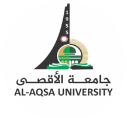

<div align="center">



# Embedded Systems Programming Labs

**Al-Aqsa University | Faculty of Engineering**

**Course:** Embedded Systems Programming (ENGS4305)

**Academic Year:** 2026–2027

**Instructor:** Eng. Shahd Albadrasawi

**Language:** C

</div>

---

## Overview

This repository contains practical laboratory exercises and reports for the **Embedded Systems Programming** course at Al-Aqsa University.

The labs focus on developing a foundation in C programming through hands-on exercises covering variables, input/output operations, conditional statements, loops, functions, and arrays.

Each lab includes C source code, execution screenshots, and a report documenting the required exercises and key programming concepts.

## Lab Contents

| Lab | Topic | Main Concepts |
|---|---|---|
| Lab 01 | Introduction to C Programming | Basic program structure, compilation, and output |
| Lab 02 | Variables | Data types, variable declarations, and basic operations |
| Lab 03 | scanf & Arithmetic Operators | User input, arithmetic expressions, and conversions |
| Lab 04 | Conditions | `if`, `else if`, `else`, nested conditions, and `switch` |
| Lab 05 | Loops | `for`, `while`, and `do-while` |
| Lab 06 | Functions & 1D Arrays | Functions, parameters, return values, arrays, and array processing |

## Repository Structure

```text
Embedded Systems Lab 26/
│
├── assets/
│   └── alaqsa-logo.png
│
├── Lab1- Introduction to C Programming/
├── Lab 2 -Variables/
├── Lab 3-scanf & Arithmetic Operators/
├── Lab 4-Conditions/
├── Lab 5-Loops/
├── Lab 6-Functions/
│
└── README.md
```

Each lab generally follows this structure:

```text
Lab Folder/
│
├── Code & Execution/
│   ├── ex1.c
│   ├── ex2.c
│   └── ...
│
├── Results & Screenshots/
│   ├── ex1 output.png
│   ├── ex2 output.png
│   └── ...
│
└── Lab-Report.md
```

## Tools & Technologies

- **Programming Language:** C
- **Development Environment:** Visual Studio Code
- **Compiler:** GCC
- **Version Control:** Git & GitHub
- **Documentation:** Markdown

## Learning Outcomes

Through these labs, the following concepts are practiced:

- Writing, compiling, and executing C programs.
- Working with variables, data types, and standard input/output.
- Applying arithmetic and logical operators.
- Implementing conditional statements and loops.
- Creating reusable functions and passing parameters.
- Storing and processing data using one-dimensional arrays.
- Organizing source code and documenting execution results.

## Running the Programs

To compile a C source file using GCC:

```bash
gcc ex1.c -o ex1
```

Run the compiled program on Windows:

```bash
.\ex1.exe
```

The programs are independent exercises and can be compiled and executed separately.

## Author

**Samar M. Balousha**

Intelligent Systems and Computer Engineering

Al-Aqsa University

[GitHub](https://github.com/Samarbal)

---

*This repository is maintained for academic learning and documentation purposes.*